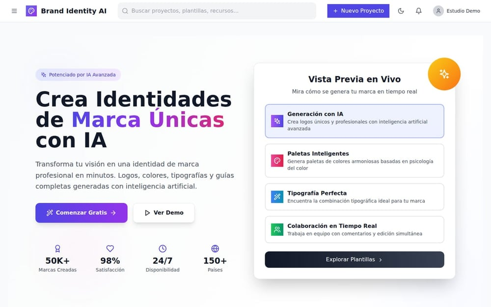
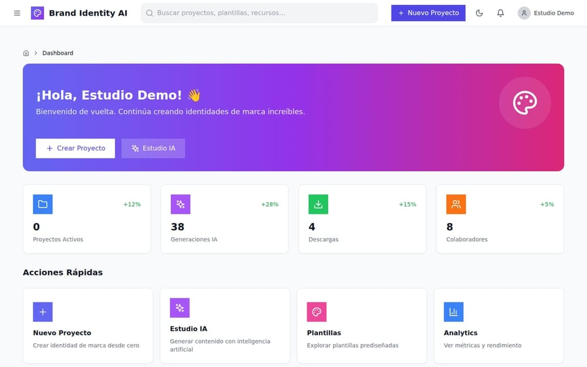
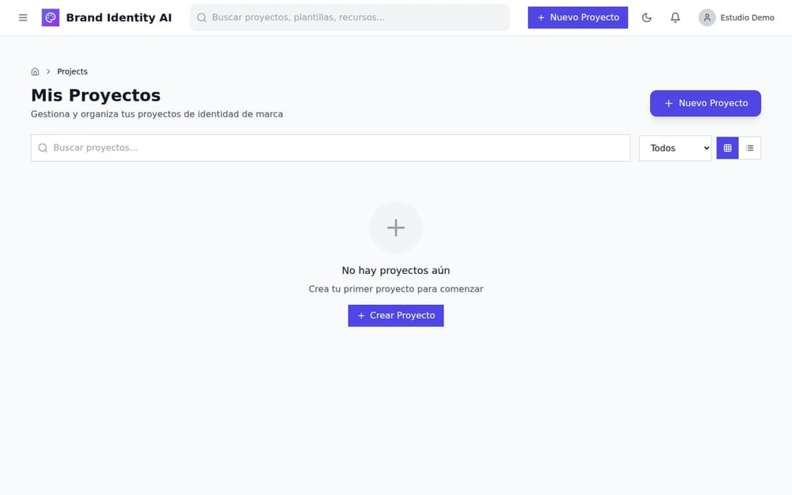
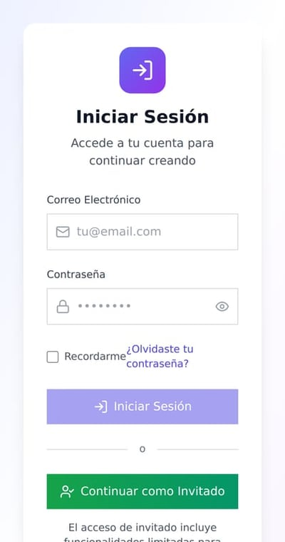

# Brand Identity AI — plataforma de identidad de marca

> **Escaparate público.** Versión de portafolio de este producto para demostrar diseño,
> arquitectura y flujos. No incluye código fuente, infraestructura ni credenciales.

Plataforma para crear y gestionar identidades de marca: portada de producto, panel de trabajo con
métricas y galería de proyectos. React + TypeScript + Redux Toolkit.

**Versión:** 1.0.0 · **Año:** 2026 · **Estado:** 3 áreas completas, resto en construcción

## Galería

**Escritorio**

|  <b>Portada</b> |  <b>Panel</b> |  <b>Proyectos</b> |
|---|---|---|

**Móvil**

|  <b>Móvil · Portada</b> |  <b>Móvil · Panel</b> |  <b>Móvil · Proyectos</b> |
|---|---|---|

*6 capturas del build real, tomadas con una **sesión de demostración** (sin datos de clientes).
Cada imagen abre la versión completa; todas están en [`vitrina/screenshots/`](vitrina/screenshots).*

## Qué está implementado

| Área | Estado |
|---|---|
| Portada, panel de trabajo, proyectos, editor, acceso | ✅ completo |
| Estudio de IA, plantillas, analítica, marketplace, facturación | 🚧 en construcción |

La vitrina muestra **solo lo terminado**. Lo pendiente se declara, no se disfraza.

## Documentación

| Documento | Contenido |
|---|---|
| [`vitrina/README.md`](vitrina/README.md) | Presentación y estado por área |
| [`vitrina/docs/ARQUITECTURA.md`](vitrina/docs/ARQUITECTURA.md) | Áreas, estado global y capas |
| [`vitrina/docs/FUNCIONALIDADES.md`](vitrina/docs/FUNCIONALIDADES.md) | Qué hace hoy y qué falta |
| [`vitrina/docs/FICHA-TECNICA.md`](vitrina/docs/FICHA-TECNICA.md) | Stack, métricas y límites |

## Stack

React · TypeScript · Vite · Redux Toolkit · Tailwind · React Router

## Alcance

Es una **vitrina**: demuestra diseño y arquitectura. No hay backend conectado ni datos reales; la
sesión mostrada es de demostración.

Las capturas se generan automáticamente con Playwright desde el build compilado.

## Contacto

Soluciones Industriales Prime JC — [solinprimejc.com](https://solinprimejc.com)
