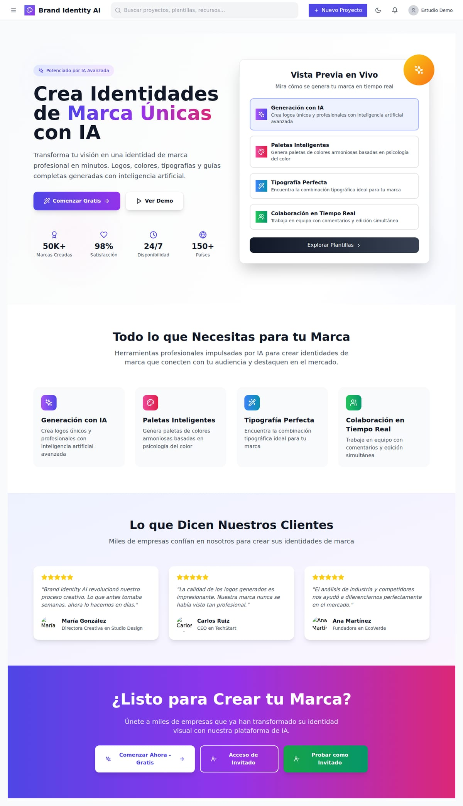
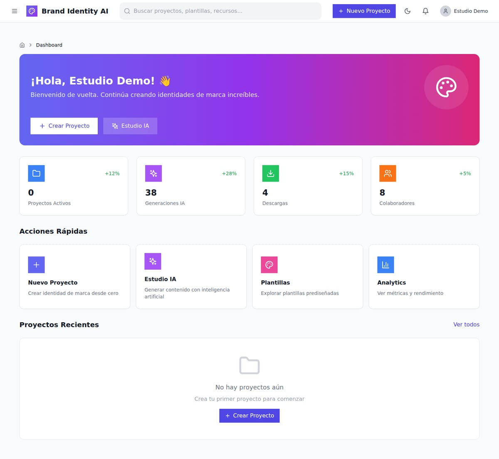
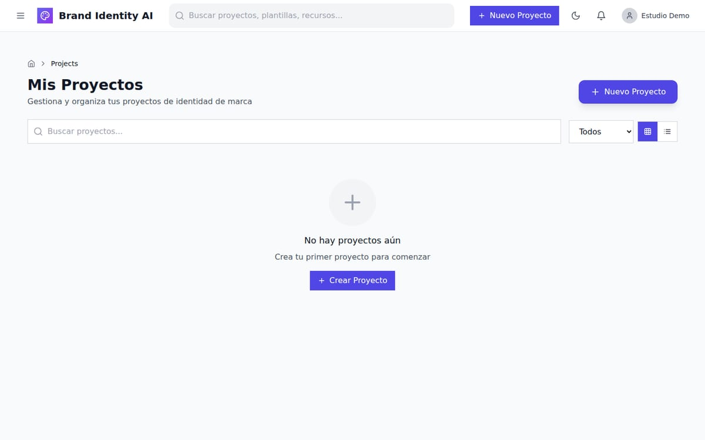
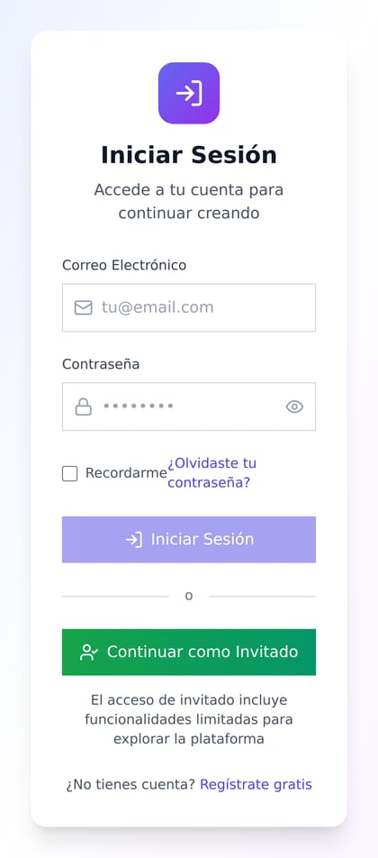
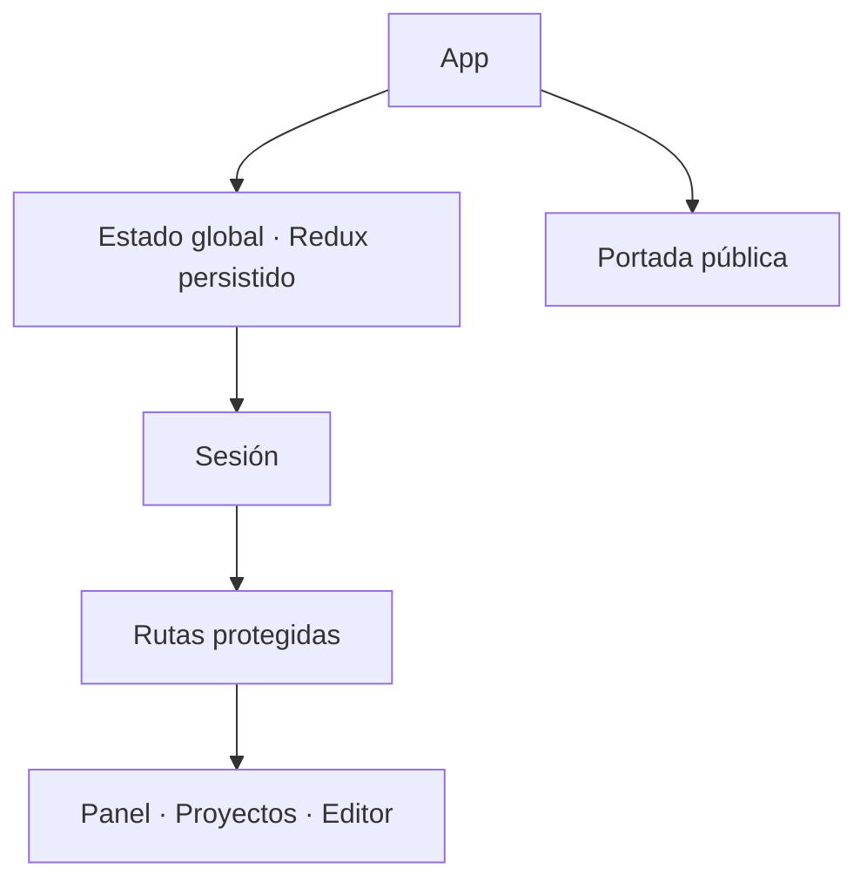

# Brand Identity AI — plataforma de identidad de marca

> Escaparate de una plataforma para crear identidades de marca: portada de producto, panel de
> trabajo con métricas y galería de proyectos. React + TypeScript + Redux Toolkit.

| | |
|---|---|
| **Tipo** | Aplicación SaaS con área pública y área privada |
| **Stack** | React 18 · Vite · TypeScript · Redux Toolkit · Tailwind |
| **Estado** | 3 áreas completas y navegables; el resto en construcción |
| **Alcance** | Demostración con sesión simulada, sin backend |

## Qué resuelve

Una marca necesita verse coherente en todos lados. Esta plataforma concentra el trabajo en un
proyecto por marca:

1. **Entra** → portada de producto con propuesta de valor y acceso.
2. **Trabaja** → panel con proyectos activos, generaciones, descargas y colaboradores.
3. **Gestiona** → galería de proyectos con estado, tipo y acceso al editor.

## Capturas

### Portada

### Panel de trabajo

### Proyectos

### Móvil
| Portada | Panel | Proyectos |
|---|---|---|
|  |  |  |

## Qué está implementado

| Área | Estado | Qué incluye |
|---|---|---|
| **Portada** | ✅ completa | propuesta de valor, vista previa y acceso |
| **Panel** | ✅ completa | métricas de uso, accesos rápidos, límites del plan |
| **Proyectos** | ✅ completa | galería con filtros, estados y acceso al editor |
| **Editor de proyecto** | ✅ funcional | edición de la identidad por módulos |
| **Acceso y registro** | ✅ funcional | inicio de sesión, registro y recuperación |
| **Estudio de IA** | 🚧 en construcción | interfaz declarada, sin generación conectada |
| **Plantillas** | 🚧 en construcción | — |
| **Analítica** | 🚧 en construcción | — |
| **Marketplace** | 🚧 en construcción | — |
| **Facturación** | 🚧 en construcción | — |

**Nota honesta:** la vitrina muestra solo las áreas terminadas. Las demás están en el producto
como rutas declaradas y se documentan como pendientes, no como funcionalidad disponible.

## Cómo está construido

- **Estado persistido**: la sesión y los proyectos sobreviven a la recarga.
- **Guarda de ruta**: el área privada exige sesión; quien no la tiene ve el acceso.
- **Componentes por área**: el panel y la galería comparten tarjetas y tablas.

Detalle en [`docs/ARQUITECTURA.md`](docs/ARQUITECTURA.md),
[`docs/FUNCIONALIDADES.md`](docs/FUNCIONALIDADES.md) y
[`docs/FICHA-TECNICA.md`](docs/FICHA-TECNICA.md).

## Alcance de esta versión

Es una **vitrina**: demuestra diseño y arquitectura. El área privada se capturó con una **sesión de
demostración**; no hay datos de clientes ni backend conectado.

## Créditos de imágenes

Fotografías de **Pexels**, bajo su [licencia libre](https://www.pexels.com/license/).

## Contacto

Soluciones Industriales Prime JC — [solinprimejc.com](https://solinprimejc.com)
